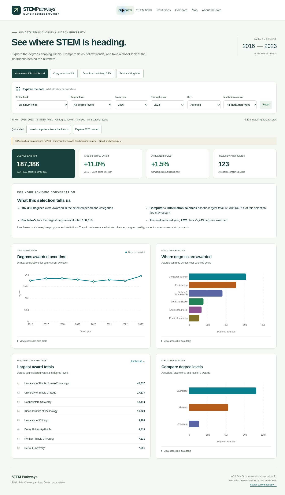

# STEM Pathways Dashboard

An Illinois STEM degree explorer for counselors, college advisors and education leaders. It turns public NCES IPEDS completions into field trends, institution profiles and comparisons. The app uses React, Vite and Recharts with a reproducible Python pipeline. It has no accounts, student records or database.

**Stage: Validation and Handover.** The release candidate is deployed. The code and deliverables are published on the integration branch `feature/stem-dashboard`. Teammate approval, sponsor scope acceptance and final ownership handover are tracked separately in the [acceptance ledger](docs/progress.md). A release candidate is not a claim that the team has held its demo or approved the release.

- [Open the dashboard](https://stem-pathways-dashboard.vercel.app/)
- [User guide](docs/user-guide.md) · [Five questions and checked answers](docs/demo-answers.md)
- [Team and role reports](docs/reports/README.md) · [Deliverables index](docs/deliverables.md)
- [Validation evidence](docs/qa/results.md) · [Data contract](docs/data-plan-and-contract.md)
- [Cleaning notebook](notebooks/clean_ipeds.ipynb) · [Open in Colab](https://colab.research.google.com/github/APS-Data-Technologies/STEM-Pathways-Dashboard/blob/feature/stem-dashboard/notebooks/clean_ipeds.ipynb)
- [Existing Figma wireframes](https://www.figma.com/design/Rxr9Zc3exDhzLhv19xAPYd) · [Design and interaction notes](docs/design.md)



## What people can do

Use **Overview** for annual awards, field and degree-level totals, leading institutions and a short summary of the current selection. **STEM fields** ranks endpoint growth and lets users sort by growth, total or name. **Institutions** searches the historical directory and shows one college's profile. **Compare** puts up to three institutions beside one another. **Map** plots institutions with matching awards using their directory coordinates. **About the data** explains the counting rules and limits.

Field, degree level, start/end award years, city and institution control work together. Quick-start buttons show the latest computer science bachelor's awards or a period beginning with CIP 2020. Users can share the current selection, download its CSV, print an advising brief and open exact-value chart tables. Missing records remain distinct from reported zero counts.

City and control use each award year's directory. Map coordinates use the latest directory record in the snapshot. Institution comparisons describe award volume, not program quality or admission chances.

## Data snapshot

| Item | Coverage |
|---|---|
| Region | Illinois |
| Award years | 2016–2023, eight verified revised Completions members |
| STEM families | 11, 14, 15, 26, 27, 40 |
| Degrees | Associate, bachelor's, master's |
| Aggregate records | 3,808 |
| Degrees awarded | 187,386 |
| Directory institutions | 328 historical institutions; 123 with positive scoped awards |
| Counting | First majors, six-digit CIP detail, CTOTALT; no subtotal double counting |

All six JSON/CSV exports are below 2 MB each. The official CIP crosswalk review found two moves within family 15 and none across the selected family boundaries. The app retains a classification-change warning. Region, STEM definition and final-release window still need the sponsor's acceptance. The current 2024 download contains no revised member; its absence alone does not prove provisional status. See the [release review](docs/data-release-review.md).

## Local setup

Node 24 and npm are recommended. Python 3.11 or newer is needed only to rebuild the data.

```bash
git clone https://github.com/APS-Data-Technologies/STEM-Pathways-Dashboard.git
cd STEM-Pathways-Dashboard
git switch feature/stem-dashboard
npm ci
npm run dev
```

Open the URL Vite prints. The cleaned data ships with the app, so no raw download is needed for normal use. In the handover ZIP, run the commands from `project/`. After the reviewed PR merges, new work should branch from `main`.

```bash
npm test
npm run build
npm run preview
```

## Rebuild and validate data

```bash
python -m venv .venv
# macOS/Linux
source .venv/bin/activate
# Windows PowerShell: .venv\Scripts\Activate.ps1
python -m pip install -r requirements.txt
python scripts/build_data.py
python scripts/verify_data.py
python scripts/verify_questions.py
python scripts/review_cip.py
python scripts/run_notebook.py
```

The notebook verifies the source checksums and then reproduces the six committed exports byte for byte. The in-process IPython runner executes all seven code cells and saves real outputs. A teammate should also run the shared Colab link for acceptance. Raw ZIPs stay in ignored `data/raw/`; use `--offline` on the build command to reuse them. An upstream checksum change requires an explained snapshot update and new checks, not a silent override.

Validation includes 15 automated tests, 1,008 core filter combinations, city/control reconciliation, all 3,808 source cells, 12 source-to-live number checks and 78 live core-view filter checks. These are recorded checks, not a substitute for a counselor user test or teammate review. The build passes with a non-blocking bundle-size warning.

## Team and ownership

| Person | Role | Implemented area and evidence |
|---|---|---|
| Sri Dhanush Reddy Kondapalli | Product Owner / Project Lead + Frontend | Product questions, React pages, shared filters, comparisons, export and saved selections in `src/App.jsx`, `src/data.js`, `docs/product-plan.md` |
| Twinkle Mohan | UX/UI + Data Visualization | Charts, summaries, comparison presentation, location view and accessible tables in `src/components/`, `src/styles.css`, `docs/design.md` |
| Yoshna Bandi | Data Engineer | Raw-source rules, annual joins, schema, crosswalk review, deterministic exports and notebook in `scripts/`, `data/`, `notebooks/` |
| Shraddha Patel | QA & Documentation | Independent checks, browser evidence, bug ledger, user guide, demo and release documentation in `tests/`, `docs/qa/`, `docs/` |

The lead combines Product Owner and Frontend. This implementation was prepared with AI assistance on the lead's behalf. The table assigns responsibility for reviewing and explaining the work; it does not claim that each person personally authored every listed change. Each role report explains the actual artifacts and the review still required.

## GitHub and release process

Everyone uses their own account for genuine changes or reviews. There is no need to upload four copies of the project. Follow the [team GitHub guide](docs/github-team-guide.md). One other teammate must approve the integration PR before merge. An APS administrator must confirm branch protection and ownership. Tag `v1.0` on the reviewed `main` commit only after the acceptance gates pass.

The current production deployment uses source files submitted directly to the existing Vercel project. Git-triggered deployment is not yet verified. [Deployment and rollback instructions](docs/deployment.md) describe the remaining connection step and the tested production release.
