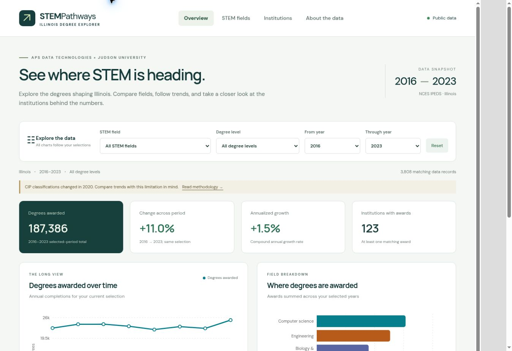

# STEM Pathways Dashboard

An interactive Illinois STEM degree-awards dashboard built for the **Fall 2026 APS Data Technologies × Judson University internship**. React + Vite + Recharts, with a reproducible Python/IPEDS data pipeline. Public aggregate data only; no student records or database.

**Status:** Week 1–3 implementation prepared locally for team review; being published through the lead’s signed-in GitHub browser session to `feature/weeks-1-3-dashboard`. This is AI-assisted work prepared on the lead's behalf, not four individuals' claimed work histories. The full task list is not signed off: Git auto-deployment, GitHub protection, CIP review, scope approvals and actual team meetings remain open.

- [Start here: task-by-task progress and remaining actions](docs/progress.md)
- [Four separate member reports](docs/reports/README.md)
- [How each member contributes to GitHub](docs/github-team-guide.md)
- [Editable Figma wireframes — 10 frames](https://www.figma.com/design/Rxr9Zc3exDhzLhv19xAPYd)
- [Cleaning notebook](notebooks/clean_ipeds.ipynb) · [Open in Colab](https://colab.research.google.com/github/APS-Data-Technologies/STEM-Pathways-Dashboard/blob/feature/weeks-1-3-dashboard/notebooks/clean_ipeds.ipynb)
- **Live public dashboard:** [https://stem-pathways-dashboard.vercel.app/](https://stem-pathways-dashboard.vercel.app/) - [deployment status and Git integration](docs/deployment.md)



## What works
- Overview annual trend, STEM-family and degree-level comparisons, top-eight institution ranking.
- Field comparison with endpoint change and compound annual growth rate.
- Searchable institution picker, institution annual trend and field mix.
- Shared field, inclusive year-range and degree-level filters; reset and clear empty states.
- About page with sources, first-major counting rule, limitations and methodology.
- Responsive layout, chart tooltips and exact-value table alternatives.
- Loading, validation, error and retry handling; small static JSON/CSV exports.

No stretch features are included: filtered CSV download, maps and narrative findings require the Week 4 go/no-go.

## Snapshot and limits
| Item | Implemented choice | Approval status |
|---|---|---|
| Region | Illinois; annual directory state | APS approval pending |
| STEM | CIP families 11, 14, 15, 26, 27, 40 | APS approval pending |
| Award years | 2016–2023; revised Completions members verified | Final-window approval pending; 2024 excluded because no revised member was present in downloaded archive |
| Degrees | Associate, bachelor's, master's | Matches requested degree levels |
| Counting | First majors, six-digit CIP detail, CTOTALT | Implemented and checked |
| CIP transition | As reported within each year's family; 2020 warning | Crosswalk/method review still open |

The snapshot contains **3,808 aggregate rows**, **187,386 awards**, and **328 historical directory institutions**; 123 institutions have positive selected STEM awards across the full period. Awards are not unique students. Missing records are not zeros. Data can include NCES imputations and later revisions. Institution/classification changes affect trends.

See [data plan, contract, counting rules and formulas](docs/data-plan-and-contract.md). Archive URLs, selected CSV members, bytes and SHA-256 are recorded in [source-manifest.json](data/source-manifest.json).

## Run locally
If you downloaded the handover ZIP, extract it and run `npm ci` / `npm run dev` inside its `project` folder. The GitHub branch commands below apply **after publishing the branch**; it does not yet exist remotely. See [START-HERE.md](START-HERE.md).

Node 24 recommended (minimum 22.12); npm and Python 3.11+ for data work.

```bash
git clone https://github.com/APS-Data-Technologies/STEM-Pathways-Dashboard.git
cd STEM-Pathways-Dashboard
git switch feature/weeks-1-3-dashboard
npm ci
npm run dev
```

Open the local URL Vite prints. The six cleaned JSON/CSV files in `public/data` are included in this handover; downloading raw data is unnecessary to use the app. After the integration PR merges, use `main` for new work.

```bash
npm test
npm run build
```

## Rebuild and verify data
```bash
python -m pip install -r requirements.txt
python scripts/build_data.py
python scripts/verify_data.py
python scripts/run_notebook.py
```

The notebook can also be opened in Colab and run top-to-bottom. On this build host, kernel sockets are restricted, so its six code cells were executed in-process with IPython and real outputs saved. A teammate's Colab UI run remains to verify. `run_notebook.py` verifies all source hashes before rebuilding and asserts exact equality against committed exports. If NCES changes a source, investigate and document the snapshot update rather than overriding the hash silently.

Raw ZIPs are cached in `data/raw` and ignored by Git. `python scripts/build_data.py --offline` rebuilds from that cache. [Pipeline stage counts](docs/qa/pipeline-audit.json), [six independent checks](docs/qa/number-checks.json), [reproducibility hashes](docs/qa/reproducibility.json) and [QA results/limitations](docs/qa/results.md) are recorded.

## Team of four
| Person | Role | Main ownership |
|---|---|---|
| Sri Dhanush Reddy | Product Owner / Lead + Frontend | Questions, scope, coordination, pages and filters |
| Name to confirm | UX/UI + Data Visualization | Figma, charts and measures |
| Name to confirm | Data Engineer | Sources, notebook, cleaning and exports |
| Name to confirm | QA & Documentation | Tests, source comparisons, docs, GitHub and Vercel |

This maps the original five roles into four; B-09 wireframes are allocated to UX/UI. Confirm names and allocation with APS. [Product plan and team norms](docs/product-plan.md) · [Asana import preparation](docs/task-board.csv) · [five-minute checkpoint script](docs/mid-project-update.md).

## Contribution and review rules
Use individual accounts, feature branches and pull requests. Each PR requires at least **one other teammate's approving review** before merge. No direct pushes to main. The initial repository inspection found main unprotected; an APS administrator must enable enforcement. The connected contributor cannot change repository administration. See [exact handover steps](docs/github-team-guide.md).

Every task needs one real owner and a due date in Asana. Stand-ups use Slack: completed / next / blockers. These external updates and meetings have not been fabricated by this implementation. Reports have personal-validation sections for members to complete after actual work. Do not share account credentials.

## Original schedule
| Phase | Dates / milestone |
|---|---|
| Week 1 | Oct 26–30: plan and design |
| Week 2 | Nov 2–6: core build; original first-deploy deadline Nov 4 |
| Week 3 | Nov 9–13: features and APS checkpoint |
| Week 4 | Nov 16–20: integration/testing; feature complete Nov 20 |
| Week 5 | Nov 23–27: light polish; freeze Nov 25 |
| Demo prep | Nov 30–Dec 4 |
| Demos / handover | Nov 30–Dec 11 |

This package was prepared Nov 6 UTC, with Week 3 artifacts early. It does not claim past deadlines, attendance or approvals were achieved. [Original repository brief](docs/original-project-brief.md) is preserved for traceability; actual status and corrected protection/deployment claims are above.
